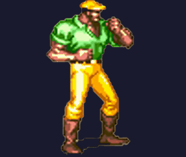

# GGPO Web Fighter

AI로 만든 캐릭터 스프라이트를 넣어 본 브라우저 2D 격투 게임 프로토타입입니다.
AI가 만든 스프라이트가 실제 게임 안에서 쓸 만한지, 그리고 격투 게임의 롤백 넷코드가 어떻게 돌아가는지 직접 보려고 만들었습니다.
[라이브 데모](https://ggpo-webgame.vercel.app)에서 **LOCAL PLAY**를 누르면 한 키보드로 둘이 바로 해 볼 수 있습니다(조작법은 아래에 있습니다).



> 위 GIF는 게임이 실제로 불러오는 `client/public/sprites`의 프레임을 이어 붙인 것입니다.

## 스프라이트 이야기

처음에는 Stable Diffusion으로 동작 프레임을 뽑았는데, 프레임마다 캐릭터의 얼굴·옷·비율이 달라져서 애니메이션으로 이어 붙이기 어려웠습니다.
그래서 AetherForge로 만든 스프라이트로 바꿔서 게임에 넣었습니다. 대기, 걷기, 대시, 점프, 앉기, 펀치·킥 콤보, 피격, 다운 같은 동작이 들어가 있습니다.
프레임에 맞춰 히트박스를 손으로 맞추기 위해 개발용 히트박스 편집기(`editor.html`)도 따로 붙였습니다.

## 롤백 넷코드에 대해

온라인 대전은 GGPO 방식의 롤백 구조를 따릅니다. 다만 이 부분은 제가 넷코드를 깊이 알고 설계한 것이 아니라, AI 코딩 도구와 함께 만들면서 동작 원리를 배워 간 결과물입니다.
대략적인 흐름은 다음과 같습니다.

1. 매 프레임 내 입력을 읽고, 상대 입력은 마지막으로 받은 값으로 예측해서 진행합니다.
2. 프레임마다 게임 상태를 저장해 둡니다.
3. 나중에 도착한 상대 입력이 예측과 다르면, 그 프레임으로 되돌아가 지금까지 다시 계산합니다.

같은 입력이면 같은 결과가 나오도록 게임 로직은 고정 60FPS 루프에서 돌고, 위치 값은 정수로 다룹니다.
현재 설정값은 입력 지연 2프레임, 최대 롤백 8프레임입니다(`client/src/network/ggpo/GGPOSession.ts`). 실제 회선에서 롤백이 얼마나 자주 일어나는지는 따로 측정하지 않았습니다.

## 기능

- **로컬 대전**: 한 키보드로 2인 대전
- **온라인 대전**: 방 만들기 / 코드로 참가 / 빠른 매칭. 시그널링 서버(Socket.io)로 연결한 뒤 WebRTC(PeerJS)로 입력을 직접 주고받습니다.
- **로딩 동기화**: 두 사람 모두 스프라이트를 다 불러온 뒤에 라운드를 시작합니다.
- **프레임 데이터**: 기술마다 발생·지속·후딜 프레임과 히트박스/피격 박스가 있습니다.
- **키 설정**: 메뉴의 CONTROLS에서 키를 바꿀 수 있습니다.
- **히트박스 편집기**(개발용): 개발 서버에서 `/editor.html`로 열어 프레임별 히트박스를 맞춥니다.

## 기술 스택

- 클라이언트: React 19, TypeScript, Vite, HTML5 Canvas 2D, Zustand
- 네트워크: WebRTC(PeerJS), Socket.io
- 시그널링 서버: Node.js, Express, Socket.io
- 배포: 클라이언트는 Vercel, 시그널링 서버는 Render

## 실행 방법

Node.js 18 이상이 필요합니다.

```bash
# 설치
cd client && npm install
cd ../server && npm install
```

```bash
# 터미널 1: 시그널링 서버 (온라인 대전에만 필요, 포트 3001)
cd server
npm run dev

# 터미널 2: 클라이언트
cd client
npm run dev
```

브라우저에서 Vite가 알려 주는 주소(기본 `http://localhost:5173`)를 열면 됩니다. 로컬 대전은 서버 없이도 됩니다.
다른 시그널링 서버를 쓰려면 클라이언트에 `VITE_SIGNALING_URL`을 지정합니다.

```bash
# 배포용 빌드
cd client && npm run build
cd ../server && npm run build && npm start
```

## 조작법

| 동작 | 1P | 2P |
| --- | --- | --- |
| 이동 | W A S D | 방향키 |
| 약펀치 | U | Numpad 7 |
| 강펀치 | I | Numpad 8 |
| 약킥 | J | Numpad 4 |
| 강킥 | K | Numpad 5 |

일시정지는 ESC, 재시작은 F5입니다.

## 폴더 구조

```
client/
  src/
    components/     메뉴, 로비, HUD, 게임 캔버스
    game/
      engine/       게임 루프, 상태, 렌더러, 스프라이트
      systems/      입력, 물리, 충돌
      data/         캐릭터 기술 데이터, 히트박스 저장값
    network/
      ggpo/         롤백 세션, 입력 버퍼, 상태 저장
      webrtc/       P2P 연결
      sync/         로딩 동기화, 연결 상태 확인
    editor/         히트박스 편집기
  public/sprites/   게임에서 쓰는 스프라이트 프레임
server/src/         시그널링·매칭 서버
sprite/             스프라이트 원본과 작업 중간 파일
```

## 한계

캐릭터는 1명(같은 캐릭터 미러전)뿐이고, 온라인 대전은 같은 PC의 브라우저 두 개끼리 연결되는 것까지만 확인했습니다.
시그널링 서버가 Render 무료 플랜이라 한동안 접속이 없으면 잠들어서, 첫 온라인 접속은 시간 초과가 날 수 있습니다. 잠시 뒤 다시 누르면 연결됩니다.

## 라이선스

MIT

GGPO라는 이름과 롤백 개념은 Tony Cannon의 GGPO에서 왔습니다.
